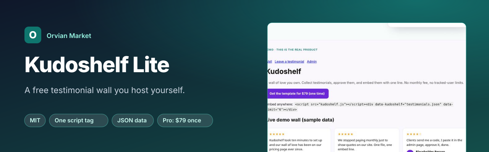

<p align="center"><a href="https://jhodges3401-code.github.io/kudoshelf-demo/"></a></p>

<p align="center">
<a href="LICENSE"></a>
<a href="https://jhodges3401-code.github.io/kudoshelf-demo/"></a>

<a href="https://github.com/jhodges3401-code/kudoshelf-lite/stargazers"></a>
</p>

<p align="center"><b><a href="https://jhodges3401-code.github.io/kudoshelf-demo/">Live demo</a></b> · <a href="#quick-start">Quick start</a> · <a href="#lite-vs-pro">Lite vs Pro</a> · ⭐ <b>Star this repo</b> if it saves you a subscription</p>

# Kudoshelf Lite: a free testimonial wall you host yourself

> **Need more than Lite?** [Kudoshelf Pro](https://jhodges6.gumroad.com/l/kudoshelf) adds the full feature set below for **$79 once**. No subscription, 14-day refund. [See the live demo →](https://jhodges3401-code.github.io/kudoshelf-demo/)

Show customer testimonials on any website from one JSON file. One script tag, zero dependencies, no monthly fee. Every field is HTML-escaped.

**Live demo of the full version:** https://jhodges3401-code.github.io/kudoshelf-demo/

## Quick start
1. Click **Use this template** (or fork), then **Settings → Pages → Deploy from branch: main / root**.
2. Put your testimonials in `testimonials.json` (`name`, `role`, `text`).
3. Embed it on any site:
```html
<div data-kudoshelf-lite="https://YOU.github.io/REPO/testimonials.json" data-limit="6"></div>
<script src="https://YOU.github.io/REPO/kudoshelf-lite.js"></script>
```


## See it in action
<p align="center"><a href="https://jhodges3401-code.github.io/kudoshelf-demo/"></a></p>

## Lite vs Pro<a id="lite-vs-pro"></a>
| | Lite (free, MIT) | [Kudoshelf Pro ($79 one-time)](https://jhodges6.gumroad.com/l/kudoshelf) |
|---|---|---|
| Embeddable testimonial grid from JSON | ✅ | ✅ |
| Collection page your customers fill in | – | ✅ |
| Approve/reject admin page | – | ✅ |
| Star ratings, avatars, tags, sorting and filtering | – | ✅ |
| Test suite, setup guide and support | – | ✅ |

## About
Built from scratch by Orvian Market. An independent alternative to subscription testimonial tools; not affiliated with Senja or any other vendor. All trademarks belong to their owners.

License: MIT (Lite only). Kudoshelf Pro is sold separately under its own license.
